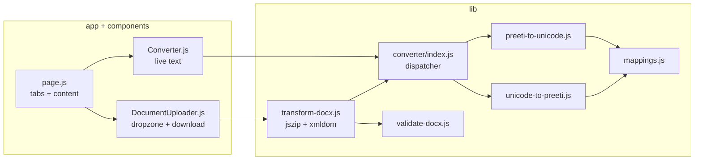

# Architecture

Next.js App Router (served by `next start`; pages are prerendered), React,
plain CSS. No database, no auth, no API routes, no server state — every
conversion runs in the browser.

## Responsibilities

- `app/`: routing, metadata, sitemap/robots, page composition, global styles.
- `components/`: interactive islands only (text panel, document panel).
- `lib/converter/`: pure functions, zero dependencies, independently tested.
- `lib/document/`: ZIP/XML pipeline, independently tested with synthetic fixtures.
- `tests/`: `node:test` suites + manual upstream-parity harness.

## Privacy boundaries

User content flows UI → lib → download. There is no network call carrying user
text or files anywhere in the codebase (verified by inspection: no `fetch` of
user data, no analytics).

## Dependency decisions

`jszip` + `@xmldom/xmldom` (both MIT) for DOCX; nothing else. Vitest was
dropped after `npm install` failed in this environment (`edgesOut` registry
bug) — Node's built-in `node:test` runner covers the suites with zero
dependencies. No Redux, no backend, no paid service.

## Deployment

`next build` produces Next.js server output (`○ /`, `○ /robots.txt`,
`ƒ /sitemap.xml`) served with `next start` on Node 20.9+ — not a static
export. Set `NEXT_PUBLIC_SITE_URL` at build time. See `docs/deployment.md`.
